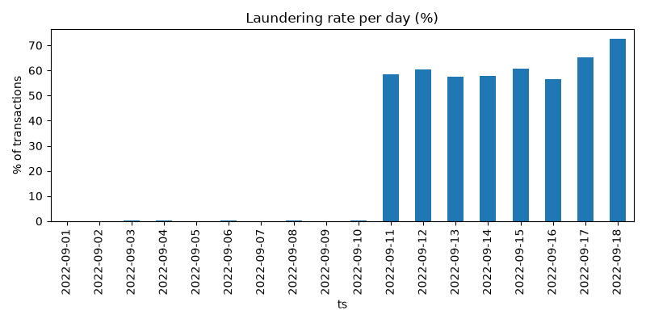
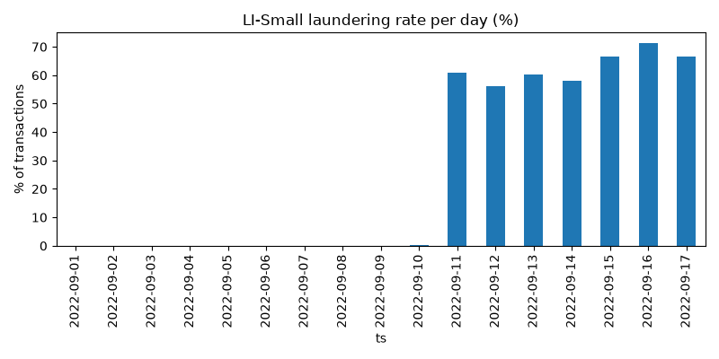
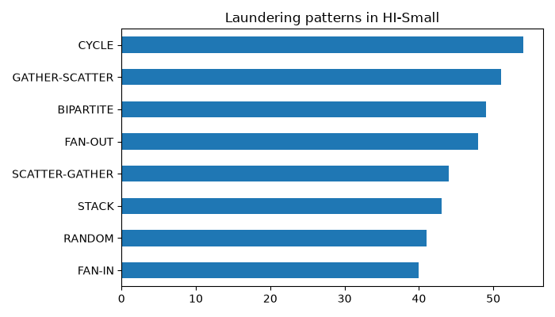
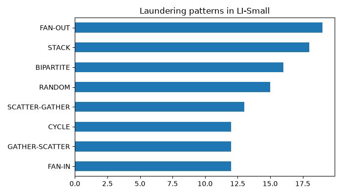

# Harm-Capped AML Screening on IBM LinuxONE

   - Live demo (frontend): https://harmcap-ui.vercel.app
   - Frontend code: https://github.com/Aashitaalsocodes/harmcap-ui
   - Video: https://drive.google.com/file/d/1spG7NF-RtLcu1AFpQxApiDA2aWoMSPg2/view?usp=sharing
- Frontend code: [/frontend](frontend) (also at https://github.com/Aashitaalsocodes/harmcap-ui)
- Architecture diagram: [docs/architecture.png](docs/architecture.png)
## Project summary
Banks' AML systems flag transactions, and most flags are innocent people who get frozen, with nobody measuring that harm. We flip the objective: the bank first sets a cap on wrongly held innocents (for example 5 per 10,000), and the system catches as much laundering as it can within that cap. We test whether the cap holds on later time windows and on a second dataset, and report the break rate. Every decision goes into a hash-chained audit log, served by a FastAPI service in Docker on IBM LinuxONE.

## Team and roles
- Data, model, thresholds: Aashita
- Platform, audit log, API, Docker: Ashmitha
- Evidence, README, exploration: M
- Video script, slides, testing: N

## How to run
Run these on the LinuxONE VM (host prompt, `linux1@lbc:~$`). The service listens on localhost only.

**Shared team VM: don't run these.** Option A rebuilds `aml-harmcap:dev`, our rollback image, and the live containers already exist. Use a free port and a new container name if you test from scratch.

**A. Test scorer (placeholder model, `/health` shows dummy-scorer-v0)**

```
cd ~/shared/ashmitha/aml-harmcap/src/platform
docker build -f deploy/Dockerfile -t aml-harmcap:dev .
docker run -d --name amlapi-test -p 127.0.0.1:<free-port>:8000 -e VERIFY_TOKEN=<your-secret> -v amlruntime:/data aml-harmcap:dev
```

**B. Real model (LightGBM, used in the video)**

```
cd ~/shared/ashmitha/aml-harmcap/src/platform
docker build -f deploy/Dockerfile.full -t aml-harmcap:real .
docker run -d --name amlreal-test -p 127.0.0.1:<free-port>:8000 -e VERIFY_TOKEN=<your-secret> -e MODEL_PATH=/model/m3.txt -e THRESHOLD=0.99506049103294 -e CAP_PER_10K=5 -v /home/linux1/shared/clean:/model:ro -v amlruntime:/data aml-harmcap:real
```

**Check it and send one transaction (use your free port)**

```
curl -s localhost:<free-port>/health
curl -s -X POST localhost:<free-port>/screen -H 'Content-Type: application/json' -d '{"txn_id":"DEMO1","src_acct":"A1","dst_acct":"B2","amount":250.0}'
curl -s localhost:<free-port>/audit/verify
```

Tamper tests (inside the notebook container, started with `docker exec -it notebook bash`):

```
cd ~/shared/ashmitha/aml-harmcap/src/platform/audit && python3 test_tamper.py
```

## Results

### Harm-cap test on later windows (HI-Small)
Thresholds were frozen on the Sep 7-8 calibration data and tested on 8 six-hour windows from Sep 9-10, without retuning. Harm is wrongly held innocent accounts per 10,000 active accounts. A window breaks when its harm is above the cap.

| Cap (per 10,000) | Recall | Mean harm | Worst window | Break rate |
|---|---|---|---|---|
| 2 | 29.0% | 0.9 | 2.1 | 1 of 8 |
| 5 | 32.8% | 9.1 | 48.8 | 2 of 8 |
| 10 | 35.4% | 209.0 | 789.3 | 4 of 8 |

The strictest cap held in 7 of 8 windows and missed only slightly in the eighth (2.1 against 2). Looser caps broke more often and by large margins. Recall rose only from 29.0% to 35.4% across the three caps, so the extra harm bought little extra detection. "Innocent" is defined from the synthetic dataset's labels.

### Transfer to a second dataset (LI-Small, no retuning)
The thresholds from the HI-Small calibration were applied without retuning to 40 windows of LI-Small, which has a lower laundering rate.

| Cap (per 10,000) | Recall | Mean harm | Worst window | Break rate |
|---|---|---|---|---|
| 2 | 11.9% | 1.9 | 7.4 | 25% of 40 windows |
| 5 | 13.4% | 6.0 | 50.0 | 35% of 40 windows |
| 10 | 15.2% | 48.0 | 745.8 | 48% of 40 windows |

The guarantee weakens on the second dataset. At cap 2 the break rate rises from 1 of 8 windows (12.5%) on HI-Small to 25% on LI-Small, and recall falls from 29.0% to 11.9%. Looser caps again break often and by large margins. This is the result the project is designed to measure: a harm cap tuned on one dataset does not automatically hold on another.

### Tamper-evident audit log
Every decision is written to a hash-chained log with signed checkpoints. A verifier walks the chain and checks the hashes, the signatures and the pinned model file. Automated tests run eight checks: six tampering attacks (edit, edit with recomputed hash, delete, reorder, truncate the tail, swap the model file) and two controls (a clean log verifies, a record replays).

Audit signing key fingerprints (SHA-256 of the DER public key, as reported by each service's /policy under audit_public_key_sha256):

- amlapi, platform API (port 8000, live demo): `36cf12035bb2476c0bd08ea4ec703506d16ab5dfcce612159c8ce448e2c47157`
- amlreal, real-model backup (port 8002): `9a9cc1eb5a0b04a2b598354930294247c3d6ea4d5d9625ba48e1e03508f0c5b1`

The public key is stored next to the log, so these values are kept here and in the video, outside the VM, so anyone can check them.

Tamper tests ran on freshly generated logs with throwaway keys, not on the live demo log.


| Test | Result | What the verifier reported |
|---|---|---|
| Untouched log verifies clean | PASS | no problems |
| Replay record 100 | PASS | decision reproduced (release) |
| 1. Edit a field | PASS | record 100: content altered (hash mismatch) |
| 1b. Edit a field and recompute its hash | PASS | record 101: chain broken (prev_hash mismatch) |
| 2. Delete a record | PASS | record 100: sequence is 101 (gap, reorder or deletion) |
| 3. Reorder records | PASS | record 100: sequence is 101 (gap, reorder or deletion) |
| 4. Truncate the tail | PASS | checkpoint 230: log ends at 220 (tail truncated) |
| 5. Swap the model file | PASS | record 1: model file does not match logged model hash |

PASS means the tamper was detected. All eight checks passed, including the edit with a recomputed hash, which breaks the link to the next record. Tail truncation is detected only back to the last signed checkpoint; records removed after the final checkpoint would not be caught.

### Load test (real model, with audit logging)
2,000 requests per concurrency level (8,000 in total) against the FastAPI service running the real LightGBM model, in a throwaway container on the LinuxONE VM. The load client ran in the same container as the API, on a shared 3-core VM, so it competed with the server for CPU. These are single-node figures, not production capacity.

| Concurrent clients | Requests | Errors | Requests/s | p50 ms | p95 ms | p99 ms |
|---|---|---|---|---|---|---|
| 1 | 2000 | 0 | 873.2 | 1.08 | 1.32 | 1.82 |
| 10 | 2000 | 0 | 796.2 | 6.53 | 51.57 | 110.23 |
| 50 | 2000 | 0 | 290.5 | 109.10 | 518.41 | 926.62 |
| 100 | 2000 | 0 | 250.4 | 171.19 | 1774.44 | 3350.01 |

There were no errors at any level (0 errors in 8,000 requests). Throughput is highest with one client and falls as concurrency rises, because the service runs a single worker, and tail latency grows from under 2 ms at one client to about 3.4 s at 100 clients. We do not claim this scales: the figures show one worker on a shared 3-core VM, with the load client competing for the same CPUs. An earlier run with the test scorer gave almost the same figures (877.5 requests/s at one client, 244.3 at 100), so the model itself is not the bottleneck. A separate real-model run by Aashita (`results/loadtest.txt`) gave consistent numbers. Source: `results/loadtest_real_model.txt`.

## Live service
The API on port 8000 (amlapi) runs the real model: LightGBM `lightgbm-m3-r24` (`m3.txt`), model hash `f4642eb27784b354fed862d4daa96cf5047ab0a93537fe864634ac7a9663e7de`, threshold 0.99506049103294, cap 5 per 10,000. Audit checkpoints are signed with Ed25519 using PyCryptodome 4.0.0, because the `cryptography` package has no usable wheel on s390x.

## Replay check
The audit log can replay a decision with the pinned model. On 20,000 consecutive HI-Small test rows, all 20,000 replayed scores were within 1e-6 of the offline m3 model scores (maximum difference 7e-8). The check ran after warm-up, on one slice of the test window, so it shows that the served model matches the offline model, not that every row was checked. Details: `results/replay_check.txt`.

## Verification tiers
Held transactions get a tier (1 to 3) based on how far the score is above the threshold, plus a required step for the customer (app confirmation, identity re-check, or manual review). A failed check escalates the case, a passed check clears it, and every attempt is written to the tamper-evident audit log. Endpoints: POST /case/{id}/verify (needs a verifier token) and GET /case/{id}. Limits: the service records a pass or fail supplied by the caller and does not verify anyone; tier ranges and pass rates are placeholders until the real score distribution exists. Step-by-step commands: docs/platform_demo.md.

## Files and links
- Datasets, libraries and references: `LINKS.md`
- Definitions used in the tests: `DEFINITIONS.md`
- Video: (link to be added)

Result files in `results/`:
- `hi_test.txt`, `li_ood.txt`: harm-cap tests
- `tamper_test.txt`: tamper tests
- `loadtest_with_logging.txt`, `loadtest_no_logging.txt`: test scorer (first run)
- `loadtest_real_model.txt`: real model, throwaway container
- `loadtest.txt`: real model, Aashita's run
- `recal.txt`: daily recalibration experiment (negative result)
- `replay_check.txt`: replay check of the served model against the offline model
- `demo_hold_sequence.json`: replayable demo hold sequence

## Data exploration

Plots made from the HI-Small and LI-Small transaction files and their pattern files.

**Laundering rate over time.** On both datasets the laundering rate per day is close to zero from 1 to 10 September, then jumps to about 56% to 73% of transactions on HI-Small (11 to 18 September) and 56% to 71% on LI-Small (11 to 17 September). This late period is almost entirely laundering, so time-based test windows must avoid it or treat it separately (see Limitations).




**Laundering patterns.** The pattern files label eight types of laundering. In HI-Small, cycle is the most frequent, followed by gather-scatter, bipartite and fan-out, and fan-in is the least frequent. In LI-Small, fan-out is the most frequent, followed by stack, bipartite and random, and cycle, gather-scatter and fan-in are the least frequent. So the mix of patterns differs between the two datasets. The pattern charts have no axis label, so we compare ranks only. Not all laundering in the data follows one of these eight patterns.




## Limitations
- The data is synthetic and has no real "innocent customer" label.
- The data spans only days to weeks, so test windows are hours or single days.
- The last days of the dataset (11 to 18 September) contain almost only laundering transactions, so time-based test windows must avoid or treat this tail separately.
- "Innocent" means "not labelled laundering" in the synthetic data, not a verified innocent customer.
- The HI-Small test has only 8 windows, so a rate like 6 of 8 is coarse. Thresholds were frozen and not recalibrated.
- Daily recalibration (threshold re-chosen each window from the previous four, skipping the latest) did not help: at cap 5 it still broke in 2 of 8 windows and the worst window rose from 48.8 to 128.8; at cap 2 recall fell from 29.0% to 13.7% (results/recal.txt).
